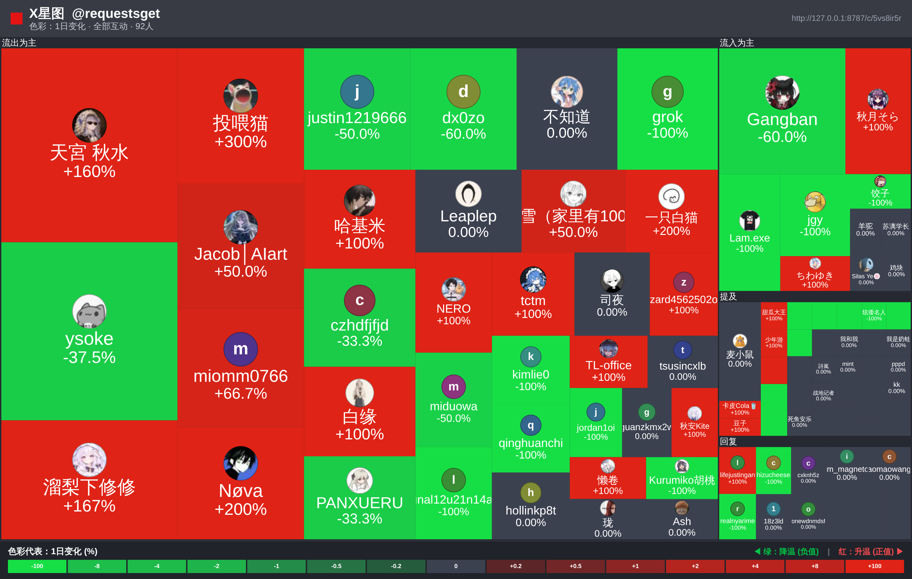

# X星图 (X Stock Hot Map)

把一个 X (Twitter) 账号的公开社交圈画成如同股市大盘板块般的热力星图。面积代表互动强度，颜色代表净流入占比或不同时间窗口的互动升温与降温。



## 功能特性

- 📈 **股市盘面风格热力图**：采用 Treemap 树图展示社交板块（双向核心、流入为主、流出为主、弱互动等），直观还原金融大盘交互体验。
- 🎨 **色彩体系（红涨绿跌 / 红流入绿流出）**：
  - **净流入占比**：🔴 红色代表外界主动互动居多的「净流入」，🟢 绿色代表自身主动互动居多的「净流出」。
  - **周期涨跌幅**：支持按 1日 / 3日 / 5日 / 10日 / 20日 / 60日 及年初至今查看互动变化率。
- 🧭 **多维度圈子筛选**：快速切换全部互动、双向圈、流入圈、流出圈、回复圈、引用圈、提及圈、转发圈以及核心50 / 核心100 等。
- 📐 **自定义指标与刻度**：
  - 面积可按互动分、互动次数、互动热度或热度比自由加权；
  - 刻度密度提供疏、标准、密、很密 4 级灵敏度调节。
- 🖼️ **一键导出高清海报与推特分享**：底部带自适应刻度图例与红绿指示说明，方便一键保存与在社交网络传播。
- ⚡ **轻量高性能**：纯 Rust (Axum + Tokio) 后端与原生 Canvas 前端，零繁重前端框架构建依赖，毫秒级响应。

## 直接运行发布包

从 [Releases](https://github.com/NetSalmon/x-stock-hot-map/releases) 下载对应系统的压缩包，解压后直接运行：

- **Linux / macOS**：
  ```bash
  ./x-stock-hot-map
  ```
- **Windows**：
  ```cmd
  x-stock-hot-map.exe
  ```

浏览器打开 [http://127.0.0.1:8787](http://127.0.0.1:8787) 即可使用。静态网页文件在旁边的 `static/`，圈子缓存数据存储于同目录的 `data/`。默认端口为 `8787`，可通过环境变量 `PORT` 自定义（例如 `PORT=8080 ./x-stock-hot-map`）。

| 预编译包 | 适用平台 |
| :--- | :--- |
| `x-stock-hot-map-x86_64-unknown-linux-gnu.tar.gz` | Linux x86_64 |
| `x-stock-hot-map-aarch64-unknown-linux-gnu.tar.gz` | Linux arm64 |
| `x-stock-hot-map-x86_64-pc-windows-msvc.tar.gz` | Windows x64 |
| `x-stock-hot-map-aarch64-apple-darwin.tar.gz` | macOS Apple Silicon (M系列) |
| `x-stock-hot-map-x86_64-apple-darwin.tar.gz` | macOS Intel |

## 从源码编译运行

需要 Rust 1.85 或更新版本。

```bash
cargo run --release
```

## 许可证

本项目采用 [GNU Affero General Public License v3.0](LICENSE)（AGPL-3.0-only）许可证开源。

Copyright (C) 2026 NetSalmon

这是一个通过网络使用的程序。分发时需附上本许可证和对应源码。修改后若继续通过网络提供给他人使用，也需向这些用户提供对应修改源码。软件按原样提供，无任何担保。
